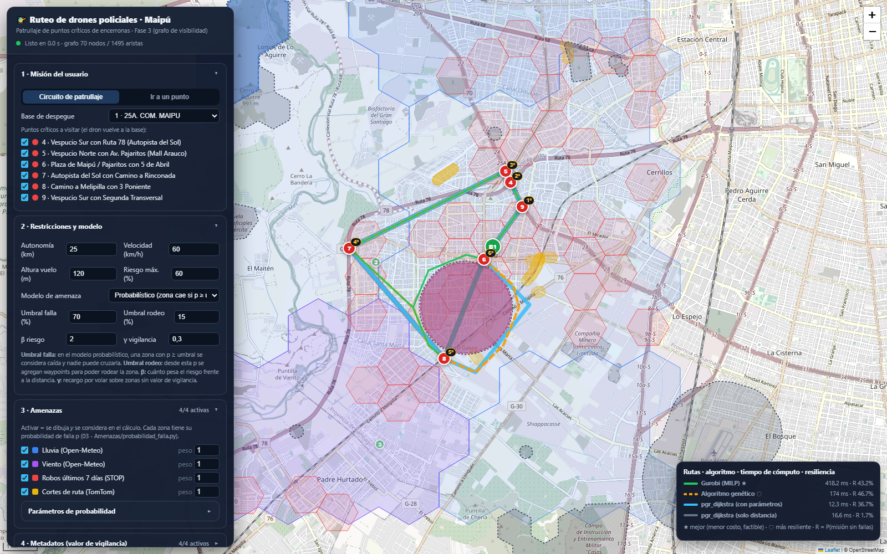
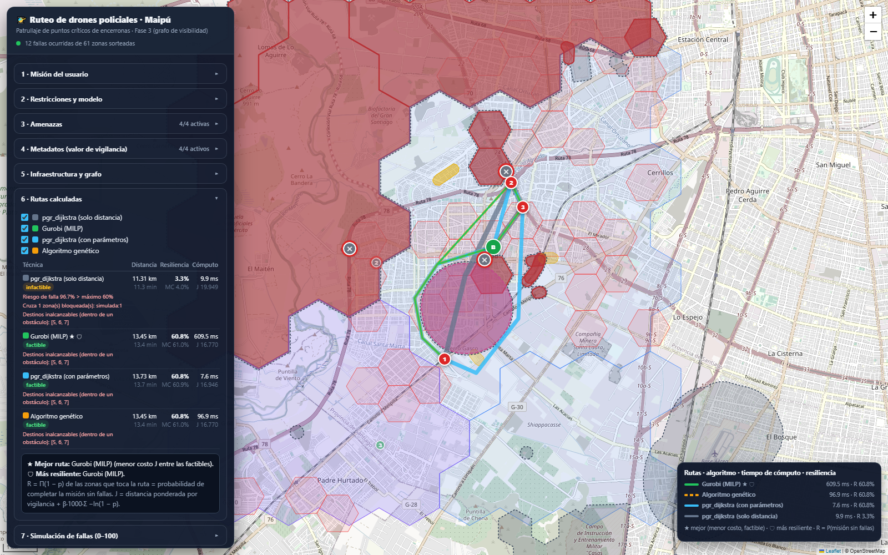

# Escenario de ejemplo: ruta alternativa frente a una amenaza (punto 9)

**Cómo reproducirlo:** abrir `http://localhost:8080/#demo`, o pulsar *▶ Cargar escenario* en la sección 8 de la web. Por API:

```bash
curl -X POST http://localhost:8080/api/rutas -H 'Content-Type: application/json' \
     -d '{"amenazas_simuladas":[{"tipo":"lluvia","lon":-70.763,"lat":-33.523,"radio_m":1300,"p":0.95}]}'
```

## Objetivo inicial

El dron de la **25ª Comisaría de Maipú (base 1)** debe patrullar los **6 puntos críticos de encerronas** (nodos 4 a 9) y volver a la base. Tiene que cumplir:
- autonomía de **25 km**;
- probabilidad de falla de la misión de **60 %** como máximo;
- no cruzar zonas restringidas ni cerros sobre su techo de vuelo (609 m s.n.m.).

Las amenazas reales son las de la extracción del 2026-11-09: lluvia y viento de Open-Meteo, robos STOP de 7 días y cortes de TomTom.

## Amenaza

Se simula una tormenta (p = 0,95, radio de 1,3 km) sobre el corredor entre la **Plaza de Maipú (6)** y **Camino a Melipilla con 3 Poniente (8)**. Ese es justo el tramo que usa la ruta más corta. Como p ≥ umbral de falla (70 %), en el modelo probabilístico la zona se considera **caída**.

## Resultado

| Técnica | Sin tormenta: km | Sin tormenta: R | Con tormenta: km | Con tormenta: R | Con tormenta: estado |
|---|---|---|---|---|---|
| pgr_dijkstra solo distancia | 15,25 | 33,9 % | 15,25 | **1,7 %** | Infactible: cruza la tormenta |
| Gurobi (MILP) ★ | 16,18 | 43,2 % | 16,86 | **43,2 %** | Factible, óptimo (0,4 s) |
| pgr_dijkstra con parámetros | 15,25 | 33,9 % | 17,49 | 36,7 % | Infactible: riesgo 63 % > 60 % |
| Algoritmo genético 🛡 | 16,18 | 43,2 % | 17,32 | **46,7 %** | Factible |



## Lectura

- **Dijkstra solo distancia** no ve amenazas. Sigue volando en línea recta de 6 a 8, a través de la tormenta, y la probabilidad de completar la misión cae a 1,7 %.
- **Gurobi** rodea la tormenta por el poniente usando los waypoints de su borde. Agrega solo **+0,68 km** respecto de su ruta sin tormenta y mantiene la misma resiliencia (43,2 %). Sigue visitando los 6 puntos y vuelve a la base dentro de los 25 km. Los objetivos iniciales se cumplen.
- **El genético** rodea la tormenta por el oriente. Su ruta es algo más larga, pero toca menos focos de robo, así que es la **más resiliente** (46,7 %). Gurobi sigue siendo la **mejor** porque minimiza el costo J, que balancea distancia y riesgo.
- **Dijkstra con parámetros** también esquiva la tormenta, pero queda infactible. Solo admite costos por arista, así que cobra varias veces las celdas de lluvia que cruzan muchos tramos y no puede imponer el límite de riesgo. Esa diferencia es la que justifica el modelo MILP.

## Simulación de fallas sobre el escenario

Con la sección 7 (*Sortear fallas*) se sortea un número entre 0 y 100 por zona: la falla ocurre si el número es menor que 100·p. La web muestra:
- qué rutas originales caen;
- los nodos que quedan inalcanzables (✕);
- las rutas recalculadas sin las zonas falladas.



> Los valores dependen de la extracción del día (clima, robos y cortes cambian), así que al reproducirlo los números pueden variar. La comparación cualitativa se mantiene mientras la tormenta simulada bloquee el corredor 6 → 8.
